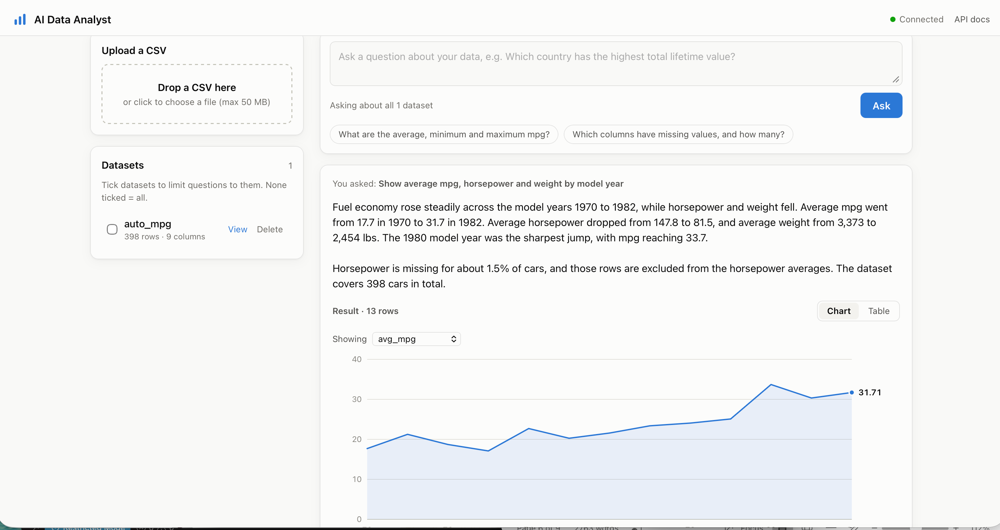

# AI Data Analyst Agent

Upload any CSV, ask questions about it in plain English, and get answers with a chart,
the result table, and the exact SQL that produced them.

An LLM agent (Claude) writes SQL, runs it through a tool against PostgreSQL, reads the
results or errors, retries when needed, and explains the answer. It connects as a
**read-only database role**, so it can never change or delete your data.

<!-- Add a screenshot: save it as docs/screenshot.png and uncomment the line below. -->
<!--  -->

## Features

- **Upload messy real-world CSVs.** Detects encoding and separator (`,` `;` tab `|`),
  converts `$1,234.50`, `83%` and European `12,5` to numbers, keeps codes like zip
  `02683` as text, reads day-first dates (`13/03/2024`), and drops Excel's blank rows.
- **Automatic profiling.** Each column is classified (id, numeric, datetime,
  categorical, text) with missing values, unique counts, ranges and examples.
- **Ask in plain English.** The agent gets a description of your tables, writes
  PostgreSQL, sees real results and errors, and corrects itself (up to 8 tool calls).
- **Verifiable answers.** Every answer shows the result as a chart or table, plus every
  SQL query the agent ran, including failed attempts.
- **Charts picked for the data.** Big numbers for 1–3 values, lines for dates and years,
  ranked bars for categories, with hover tooltips and a measure picker.
- **Dashboard.** Drag-and-drop upload, dataset details, delete, suggested questions,
  light and dark themes, and phone-width layout.

## How it works

```
Browser (HTML/CSS/JS)
   │  POST /datasets/upload            POST /ask
   ▼                                    ▼
FastAPI ── ingestion pipeline       Claude agent ── run_sql tool
   │  read → clean → profile           │  single SELECT only, read-only
   │  → CREATE TABLE → load            │  transaction, 500-row cap
   ▼                                    ▼
PostgreSQL:  meta.datasets (catalogue)   user_data.* (one table per CSV)
             written by app_rw            read by analyst_ro (SELECT only)
```

### Safety layers

| Layer | Protects against |
|---|---|
| `analyst_ro` database role with SELECT-only grants | The agent changing or deleting data |
| Read-only transactions plus a 10 s statement timeout | Writes and runaway queries |
| Pre-check: a single `SELECT`/`WITH` statement only | Multiple statements and non-query SQL |
| Sanitised table and column names | SQL injection through CSV headers |
| Data rendered with `textContent`, never `innerHTML` | Script injection from CSV values |

## Tech stack

Python · FastAPI · SQLAlchemy · pandas · PostgreSQL 16 · Docker · Anthropic Claude API
(tool use) · vanilla JavaScript with SVG charts (no build step)

## Run it locally

Requirements: Docker Desktop, Python 3.12+ (developed on 3.14), and an
[Anthropic API key](https://console.anthropic.com).

```bash
git clone https://github.com/HarshaVardhan218/ai-data-analyst.git
cd ai-data-analyst
cp .env.example .env        # then set the passwords and ANTHROPIC_API_KEY
docker compose up -d        # starts PostgreSQL and creates the roles and schemas

cd backend
python3 -m venv .venv && source .venv/bin/activate
pip install -r requirements.txt
python -m app.database.init_meta     # creates the catalogue table (first run only)
uvicorn app.main:app --reload --port 8000
```

Open http://127.0.0.1:8000 for the dashboard, or http://127.0.0.1:8000/docs for the API.

Set `AGENT_MODEL=claude-haiku-5-5` in `.env` for cheaper development. The default is
`claude-opus-5-5`.

## API

| Method | Path | Purpose |
|---|---|---|
| `POST` | `/datasets/upload` | Upload a CSV (max 50 MB) |
| `GET` | `/datasets` | List datasets with their column profiles |
| `GET` | `/datasets/{id}` | One dataset |
| `DELETE` | `/datasets/{id}` | Delete a dataset and its table |
| `POST` | `/ask` | `{"question": "...", "dataset_ids": [1]}` → answer, result, queries |
| `GET` | `/health` | API and database status |

## Project structure

```
backend/app/
  main.py              app setup, health check, serves the dashboard
  config.py            settings from .env
  api/                 datasets and agent endpoints
  services/
    csv_reader.py      robust CSV reading and type conversion
    profiling.py       column roles and statistics
    ingestion.py       upload pipeline with cleanup on failure
    table_builder.py   safe CREATE TABLE
    loader.py          bulk insert
    schema_context.py  dataset description given to the model
    sql_runner.py      read-only query execution
    agent.py           Claude tool-use agent
  database/, models/, schemas/
frontend/              index.html, styles.css, app.js, chart.js
docker/                PostgreSQL role and schema setup
```

## Limitations

- CSV only (export Excel files to CSV first), up to 50 MB, one table per file.
- No conversation memory yet: each question is answered on its own.
- Single user with no authentication, so it's meant to run locally.
- The agent's written summary can occasionally round numbers loosely; the chart and
  table always show the exact database values.
- No automated test suite yet.

## Roadmap

- pytest suite and CI
- Retrieval (RAG) over data dictionaries using pgvector
- MCP server exposing the datasets
- An evaluation set of questions with known answers to measure accuracy
- Run the whole stack with one `docker compose up`
